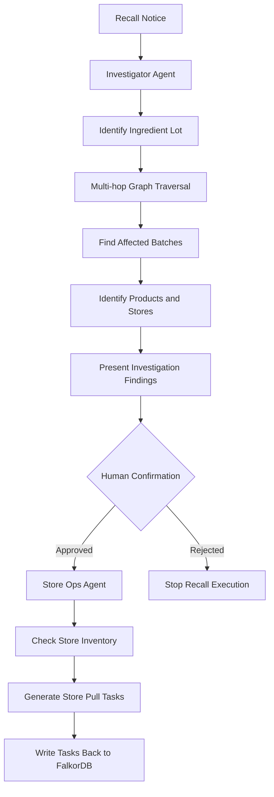

# RecallTracer 🌐
### AI-Powered Supply Chain Recall Investigation & Traceability System

**Built for the WeMakeDevs Graph Hacks 2026 Hackathon | Powered by FalkorDB**

RecallTracer is an AI-assisted supply chain recall investigation system that uses graph databases and intelligent agents to trace contaminated ingredients across complex supply chains, identify affected products and batches, and coordinate targeted product recalls across retail stores.

Instead of manually investigating disconnected supplier, manufacturing, and retail records, RecallTracer uses **FalkorDB's graph-based relationships** to perform multi-hop investigations and determine the potential impact of a contaminated ingredient.

The system combines graph-powered investigation, AI-assisted reasoning, human approval, and automated store-level recall task generation to make product recalls faster, more traceable, and more organized.

---

## 🎯 Problem Statement

Modern supply chains involve multiple suppliers, ingredients, manufacturing batches, finished products, distributors, and retail stores.

When a contaminated ingredient is discovered, identifying all affected products and determining where they have been distributed becomes a challenging task.

Traditional systems often struggle with:
- Tracing ingredients across multiple levels of a supply chain.
- Identifying every affected product and manufacturing batch.
- Determining which retail stores contain affected stock.
- Preventing unnecessary recalls caused by incorrect matches.
- Coordinating recall operations across multiple stores.

**RecallTracer addresses these challenges through graph-based supply chain intelligence.**

---

## 💡 Our Solution

RecallTracer creates an interconnected supply chain knowledge graph using FalkorDB.

When a recall notice is received, the system:

1. Investigates the reported ingredient or contaminated lot.
2. Traces its relationships with manufacturing batches and finished products.
3. Identifies potentially affected retail inventory.
4. Presents investigation findings for human confirmation.
5. Generates store-level product removal tasks.
6. Tracks recall operations through linked graph records.

The system uses two specialized AI agents to separate investigation from operational execution.

---

## ✨ Key Features

### 1. Graph-Based Supply Chain Mapping
- Represents suppliers, ingredient lots, products, and manufacturing batches as graph nodes.
- Maintains relationships between different supply chain entities.
- Uses FalkorDB to perform multi-hop graph traversal.
- Supports investigation across interconnected supply chain records.

### 2. AI-Powered Investigation Agent
The Investigator Agent:
- Analyzes recall notices.
- Identifies relevant ingredient lots.
- Traces affected batches and finished products.
- Checks previous investigation findings.
- Retrieves connected graph paths to support its conclusions.

### 3. Store Operations Agent
The Store Ops Agent:
- Checks affected products across retail stores.
- Examines available stock.
- Checks existing recall tasks.
- Generates store-specific product removal tasks.
- Writes operational updates back into the graph.

### 4. Human-in-the-Loop Approval
RecallTracer incorporates a human confirmation step before operational recall tasks are generated.

This helps prevent false-positive investigations from directly triggering unnecessary product removal operations.

### 5. Graph-Based Memory and Traceability
- Stores investigation findings as connected graph records.
- Maintains relationships between recall notices, batches, products, and store tasks.
- Enables previously recorded findings to be considered during subsequent investigations.

### 6. Interactive Visualization
The Streamlit interface provides a way to explore the supply chain investigation and visualize connected graph entities and relationships.

---

## 🏗️ System Architecture

RecallTracer uses two interconnected FalkorDB graphs:

**1. Network Graph**

Represents the upstream supply chain.

Entities include:
- Suppliers
- Ingredient Lots
- Products
- Manufacturing Batches
- Recall Notices

**2. BazaarMart Graph**

Represents downstream retail operations.

Entities include:
- Stores
- Sections
- Locations
- Associates
- Customers
- Purchases
- Batch References
- Stock Records
- Recall Tasks

The two graphs are connected logically through batch references, allowing the system to trace an ingredient from its supplier through manufacturing and into retail inventory.

### Investigation Workflow



---

## 🛠️ Technology Stack

| Technology | Purpose |
|---|---|
| Python | Core application development |
| FalkorDB | Graph database and relationship traversal |
| Cypher | Graph querying and investigation |
| LangGraph | Agent orchestration and workflow management |
| Qwen3 | Local LLM for AI-assisted reasoning |
| LM Studio | Local LLM execution |
| Streamlit | Interactive application interface |
| streamlit-agraph | Graph visualization |
| Docker | FalkorDB containerization |

---

## 🔍 Example Use Case: Groundnut Oil Contamination

Consider a scenario where a particular groundnut ingredient lot, `GN-2214`, is reported as contaminated.

RecallTracer investigates the supply chain to determine the potential impact.

**Step 1 – Investigation**

The Investigator Agent identifies the groundnut lot and explores its connected relationships in FalkorDB.

**Step 2 – Impact Analysis**

The graph traversal identifies:
- Manufacturing batches associated with the ingredient.
- Finished products containing the ingredient.
- Retail batch references.
- Stores holding potentially affected inventory.

**Step 3 – Human Confirmation**

The investigation findings are presented for human review before recall operations proceed.

**Step 4 – Store Operations**

After confirmation, the Store Ops Agent checks inventory and generates product removal tasks for affected stores.

**Step 5 – Graph Writeback**

The generated recall tasks are stored as linked graph records, allowing operational status to be tracked.

---

## 📊 Demo Dataset

RecallTracer uses seeded demonstration data to simulate a connected supply chain and retail environment.

| Dataset | Seeded records |
|---|---:|
| Suppliers | 20 |
| Ingredient Lots | 90 |
| Products | 60 |
| Manufacturing Batches | 300 |
| Recall Notices | 1 |
| Retail Stores | 12 |
| Store Sections | 72 |
| Store Locations | 216 |
| Associates | 70 |
| Customers | 1,500 |
| Purchases | 12,000 |
| Batch References | 300 |

These interconnected records demonstrate how a single contaminated ingredient can affect multiple products and retail locations.

---

## 🚀 Getting Started

### Prerequisites

Make sure you have the following installed:

- Python 3.11
- Docker Desktop
- FalkorDB
- LM Studio
- Git

### 1. Clone the Repository

```bash
git clone https://github.com/sonarsushant/recall-tracer.git

cd recall-tracer
```

### 2. Create a Virtual Environment

```bash
python -m venv recalltracer
```

Activate it on Windows:

```bash
recalltracer\Scripts\activate
```

### 3. Install Dependencies

```bash
python -m pip install -r requirements.txt
```

### 4. Start FalkorDB

Start your FalkorDB Docker container and ensure that the database is accessible on port `6379`.

### 5. Configure the Local LLM

- Open LM Studio.
- Load the Qwen3 model.
- Start the local inference server.
- Configure the application to use the local model endpoint.

### 6. Start the Application

Run the Streamlit application using the appropriate application entry point:

```bash
streamlit run app.py
```

For agent development and debugging, the project also uses LangGraph development tooling.

Refer to `SETUP.md` for the complete environment configuration and setup instructions.

---

## 📁 Project Structure

```text
recall-tracer/
│
├── agents.py
├── app.py
├── app_agent.py
├── investigator.py
├── graph_view.py
├── eval.py
│
├── queries/
│   └── *.cypher
│
├── scripts/
│
├── langgraph.json
├── requirements.txt
├── Dockerfile
├── docker-compose.yml
│
├── SETUP.md
└── DEMO_WORKFLOW.md
```

---

## 🧪 Evaluation & Hackathon Results

RecallTracer was evaluated as part of the WeMakeDevs Graph Hacks 2026 hackathon.

**Final Score: 15/30**

| Evaluation Criteria | Score |
|---|---:|
| Use of FalkorDB | 6/10 |
| Agent Effectiveness | 3/5 |
| Explainability and Provenance | 2/5 |
| Potential Impact | 2/5 |
| Creativity and Presentation | 2/5 |
| **Total** | **15/30** |

### Judge's Feedback

The evaluation recognized that:
- All 7 scripted FalkorDB evaluation checks passed.
- Multi-hop `USED_IN` queries returned complete node paths.
- Confirmed findings and store tasks were written back as linked nodes.
- The human approval gate was enforced in code.

### Areas Identified for Improvement

The judge highlighted several opportunities to strengthen the implementation:

1. **Graph Algorithm:** Fix the shortest-path call, which was identified as the main technical flaw.
2. **Agent Evaluation:** Test the actual LangGraph agents rather than relying only on the scripted database workflow.
3. **Tool Error Handling:** Surface tool errors more clearly.
4. **LLM Testing:** Evaluate the behavior and reliability of the LLM-powered agents.
5. **Confirmation Provenance:** Record human confirmation details to improve explainability and auditability.

The feedback provides a clear direction for making RecallTracer more reliable, explainable, and production-ready.

---

## 🔮 Future Enhancements

- Improve shortest-path graph traversal.
- Add comprehensive testing of LangGraph agents.
- Strengthen agent tool error handling.
- Maintain detailed human approval and confirmation records.
- Improve investigation provenance and audit trails.
- Introduce more advanced recall impact analysis.
- Support larger and more diverse supply chain datasets.
- Improve the interactive graph exploration interface.

---

## 👥 Team

Built with teamwork and experimentation for **WeMakeDevs Graph Hacks 2026**.

---

## ❤️ Acknowledgements

- [FalkorDB](https://www.falkordb.com/) – Graph database powering supply chain relationships and investigations.
- [LangGraph](https://www.langchain.com/langgraph) – Agent orchestration.
- [Streamlit](https://streamlit.io/) – Interactive application interface.
- [LM Studio](https://lmstudio.ai/) – Local LLM execution.

---

**RecallTracer – Connecting the Supply Chain. Tracing the Impact. Coordinating the Recall.**
